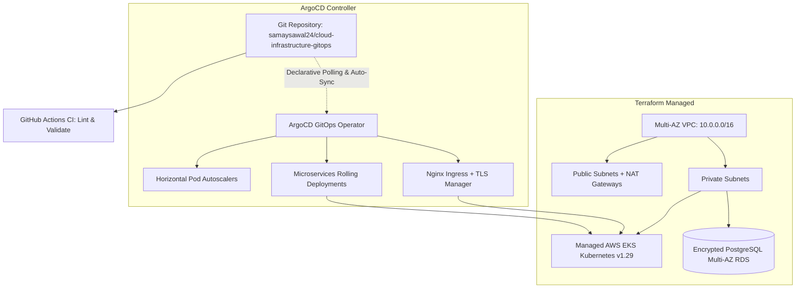

# Cloud Infrastructure as Code & GitOps Platform

[](LICENSE)
[](https://www.terraform.io)
[](https://kubernetes.io)
[](https://argo-cd.readthedocs.io)
[](https://aws.amazon.com)
[](https://github.com/samaysawal24)

Production Infrastructure-as-Code (IaC) and declarative Kubernetes GitOps automation. Provisions a high-availability AWS VPC across multiple Availability Zones, managed AWS EKS Kubernetes clusters, encrypted Multi-AZ RDS PostgreSQL instances, ingress controller with automated Let's Encrypt TLS certificates, and self-healing ArgoCD sync manifests.

---

## 🏛️ System Architecture



---

## 🚀 Key Features

- **Zero-Downtime Rolling Upgrades:** Declarative Kubernetes deployments configured with `maxUnavailable: 0` and granular readiness probes.
- **Automated Horizontal Pod Autoscaling (HPA):** Elastic scale-out up to 25 replicas dynamically balancing 70% CPU thresholds.
- **Enterprise Network Segmentation:** All databases and compute nodes reside in isolated private subnets accessible only via bastion or mTLS ingress.
- **GitOps Continuous Delivery:** Powered by ArgoCD with automated drift detection, reconciliation, and declarative rollbacks.
- **Automated Terraform CI:** GitHub Actions workflow verifying syntax, provider formatting, and plan validations on pull requests.

---

## 📦 Project Structure

```
cloud-infrastructure-gitops/
├── .github/
│   └── workflows/
│       └── terraform-ci.yml    # Linting and plan validation workflow
├── terraform/
│   ├── main.tf                 # VPC, EKS Cluster & RDS PostgreSQL resources
│   ├── outputs.tf              # Endpoints, cluster credentials & ARNs
│   ├── variables.tf            # Parameter declarations
│   └── terraform.tfvars.example# Sample deployment configurations
├── kubernetes/
│   ├── argocd/
│   │   └── application.yaml    # Declarative GitOps ArgoCD application
│   └── base/
│       ├── deployment.yaml     # Microservice deployment spec
│       ├── hpa.yaml            # Horizontal Pod Autoscaler
│       ├── ingress.yaml        # NGINX Ingress controller & TLS cert
│       └── service.yaml        # ClusterIP service definition
├── LICENSE                     # MIT License (smay)
└── README.md
```

---

## ⚡ Quickstart

### 1. Terraform Deployment

```bash
cd terraform
cp terraform.tfvars.example terraform.tfvars

terraform init
terraform plan
terraform apply -auto-approve
```

### 2. Configure Local Kubectl Context

```bash
aws eks update-kubeconfig --region us-east-1 --name apex-prod-eks
```

### 3. Apply Kubernetes Manifests

```bash
kubectl apply -f kubernetes/base/
```

### 4. Deploy ArgoCD Application

```bash
kubectl apply -f kubernetes/argocd/application.yaml
```

---

## 📜 License & Author

- **Author:** smay ([@samaysawal24](https://github.com/samaysawal24))
- **Email:** cricketworldsamay@gmail.com
- **License:** Released under the [MIT License](LICENSE).

